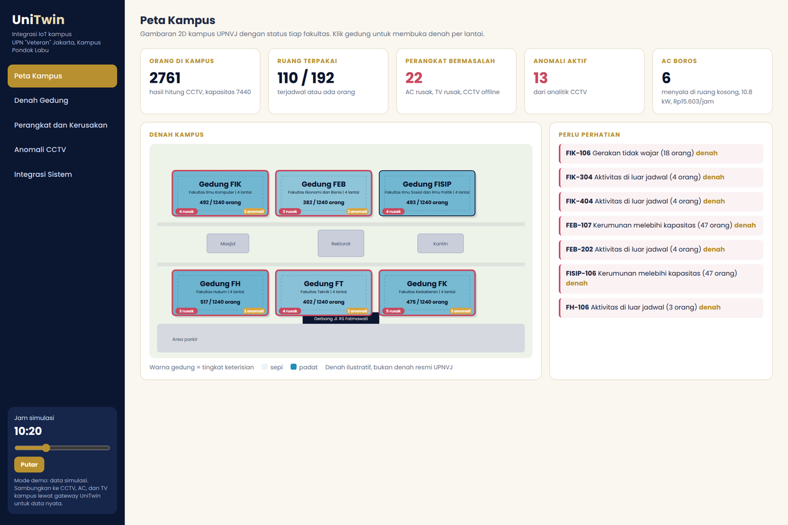
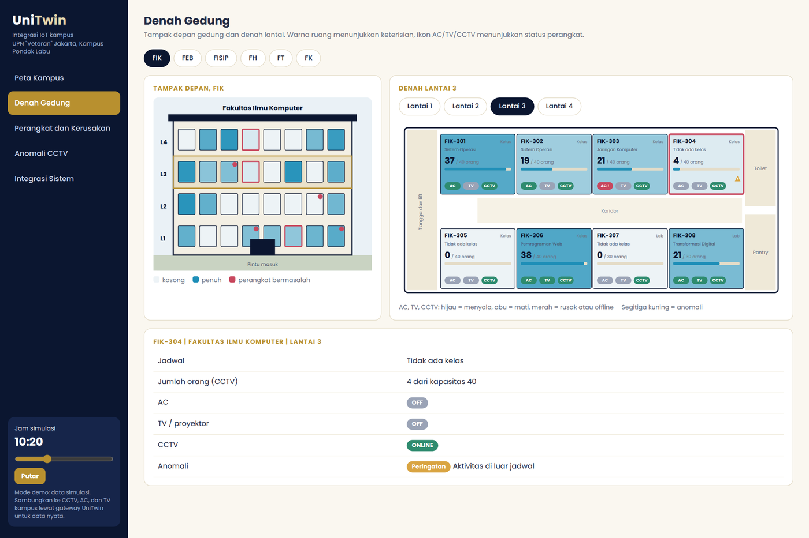
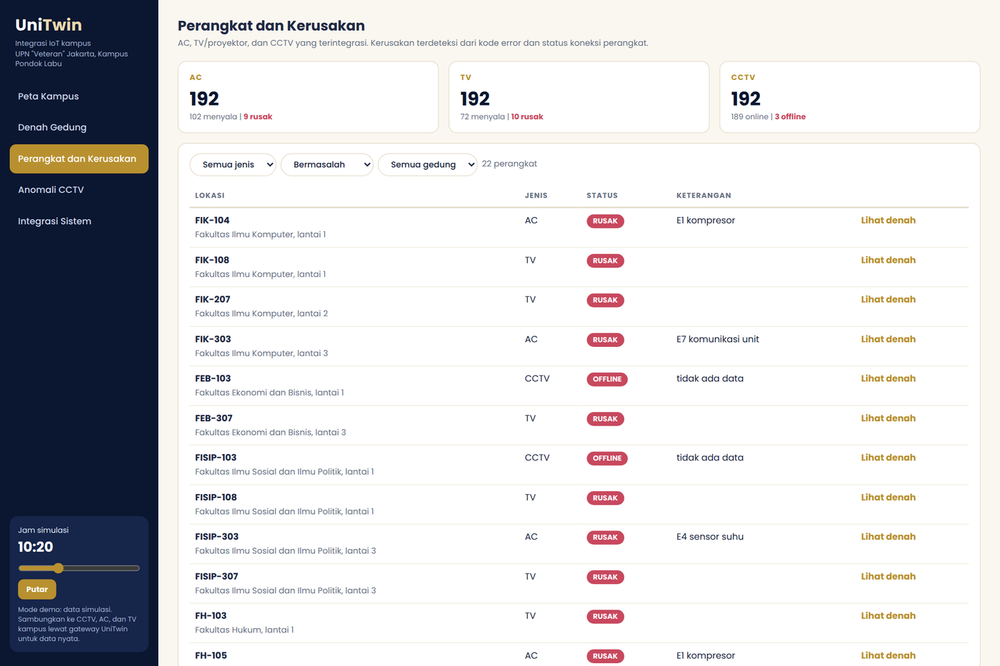
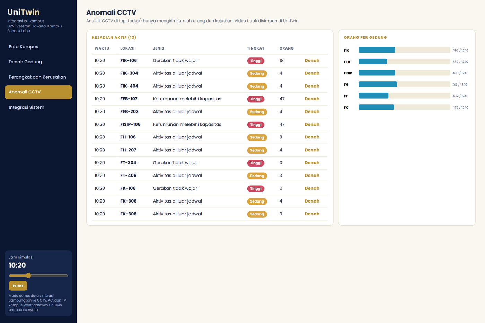
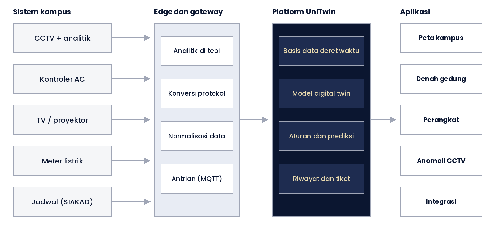

# UniTwin: Digital Twin Kampus Terintegrasi IoT

Prototipe aplikasi yang **menyatukan CCTV (hitung orang dan anomali), AC, TV/proyektor, dan jadwal kuliah** dalam satu denah 2D kampus, fakultas, gedung, lantai, dan kelas. Dibuat sebagai Tugas Akhir mata kuliah Transformasi Digital, Program Studi S1 Sistem Informasi, UPN "Veteran" Jakarta.

> **Catatan penting:** seluruh data adalah **simulasi**, dan denah kampus bersifat **ilustratif** (bukan denah resmi UPNVJ). Proyek ini tidak berafiliasi dengan sistem resmi kampus.

## Gagasan

Kampus modern sudah punya banyak sistem pintar, tetapi masing-masing berdiri sendiri. UniTwin tidak menggantikannya; ia menjadi lapisan penyatu. Dengan **anggapan** kampus sudah memiliki:

- CCTV dengan analitik penghitung orang dan deteksi anomali,
- AC dengan kontroler yang melaporkan status menyala/mati dan kode kerusakan,
- TV/proyektor yang dapat dipantau,
- jadwal kuliah digital (mis. dari SIAKAD),

pengelola dapat melihat isi tiap kelas, perangkat yang rusak, ruang yang boros listrik, dan kejadian tidak wajar di satu aplikasi.

## Fitur

| Menu | Isi |
| --- | --- |
| Peta Kampus | Denah kampus 2D, warna gedung = tingkat keterisian, ringkasan (orang, ruang terpakai, perangkat bermasalah, anomali, AC boros) |
| Denah Gedung | Tampak depan gedung 4 lantai, denah per lantai, jumlah orang per kelas, status AC/TV/CCTV, detail ruang, pembuatan tiket perbaikan |
| Perangkat dan Kerusakan | Daftar AC, TV, CCTV dengan filter, kode error, tautan ke denah |
| Anomali CCTV | Kerumunan melebihi kapasitas, gerakan tidak wajar, aktivitas di luar jadwal |
| Integrasi Sistem | Alur sistem kampus, gateway, platform, aplikasi, dan catatan privasi |

Slider **jam simulasi** mengubah isi kelas sepanjang hari (06.00 sampai 20.00).

## Tampilan






## Arsitektur



1. **Sistem kampus:** CCTV + analitik, kontroler AC, TV/proyektor, meter listrik, jadwal akademik.
2. **Edge dan gateway:** analitik di tepi, konversi protokol, normalisasi data.
3. **Platform UniTwin:** basis data deret waktu, model digital twin, aturan dan prediksi.
4. **Aplikasi:** peta kampus, denah gedung, perangkat, anomali, integrasi.

## Cara menjalankan

Prototipe berjalan penuh di browser, tanpa server dan tanpa database.

**Cara 1, buka langsung.** Unduh repositori lalu klik dua kali `docs/index.html`.

**Cara 2, GitHub Pages.** Di repositori: Settings > Pages > Source: *Deploy from a branch* > Branch: `main`, folder: `/docs`. Tautan hasilnya dapat dijadikan kode QR.

**Cara 3, Google Apps Script.**
1. Buka [script.google.com](https://script.google.com), buat proyek baru.
2. Tempel isi `apps-script/Code.gs` ke `Code.gs`.
3. Buat file HTML bernama `Index`, tempel isi `apps-script/Index.html`.
4. Deploy > New deployment > Web app > Execute as: *Me*, Who has access: *Anyone*.

## Struktur folder

```
unitwin-digital-twin-kampus/
├── README.md
├── LICENSE
├── .gitignore
├── apps-script/
│   ├── Code.gs            doGet (menyajikan halaman) dan doPost (contoh penerima data gateway)
│   ├── Index.html         salinan aplikasi untuk Apps Script
│   └── appsscript.json    manifest (zona waktu Asia/Jakarta, web app)
└── docs/
    ├── index.html         aplikasi utama (juga sumber GitHub Pages)
    └── screenshots/       tangkapan layar dan diagram arsitektur
```

## Model data simulasi

- 6 fakultas (FIK, FEB, FISIP, FH, FT, FK), masing-masing 4 lantai dan 8 ruang per lantai, total **192 ruang**.
- Tiap ruang: jadwal kuliah, jumlah orang (hasil hitung CCTV), status AC, TV, dan CCTV.
- Data dibangkitkan secara deterministik dari kode ruang dan jam simulasi (fungsi `st(r)` di `docs/index.html`), sehingga tampilannya selalu sama untuk jam yang sama.

## Menyambungkan data nyata

Ganti fungsi `st(r)` agar membaca data dari gateway UniTwin. Format yang diharapkan untuk tiap ruang:

```json
{
  "room_id": "FIK-304",
  "people": 4,
  "ac": "ON",
  "tv": "OFF",
  "cctv": "ONLINE",
  "ac_error": null,
  "anomaly": "Aktivitas di luar jadwal",
  "schedule": null
}
```

`apps-script/Code.gs` memuat contoh `doPost` untuk menerima data tersebut. Isi Script Property `API_KEY` untuk membatasi akses.

## Privasi

- Analitik CCTV berjalan **di tepi** (pada sistem CCTV). UniTwin hanya menerima **jumlah orang dan jenis kejadian**.
- Tidak ada pengenalan wajah, **video tidak disimpan**.
- Akses diatur menurut peran dan retensi dibatasi, sejalan dengan UU No. 27 Tahun 2022 tentang Pelindungan Data Pribadi. Sebelum penerapan nyata, lakukan penilaian dampak pelindungan data.

## Batasan

- Data simulasi, denah ilustratif.
- Angka penghematan dan biaya pada laporan adalah asumsi dan perlu divalidasi lewat pilot.
- Kontrol otomatis AC belum diimplementasikan; tahap awal hanya rekomendasi.

## Referensi

- Accardo dkk. (2023). *Towards a digital twin for IAQ monitoring and control in educational facilities*. University of Turin.
- Marozas-Aliaga, L. (2018). *Data driven energy efficiency strategies for commercial buildings using occupancy information*. Rochester Institute of Technology.
- Sohn dkk. (2010). *Occupancy-based energy management in buildings* (LBNL-3693E).
- Weill, P., & Ross, J. W. (2004). *IT governance*. Harvard Business School Press.

## Tim

Kelompok 2 Kelas C: Fathur Fajar Ramadhan, Muhammad Raafi Ilham, Felita Nindya Putri Devanto, Nadya Zahra Salsabila, Nuraziza Juanita Aviani.
Dosen pengampu: Andhika Octa Indarso, M.MSI.

## Lisensi

[MIT](LICENSE)
